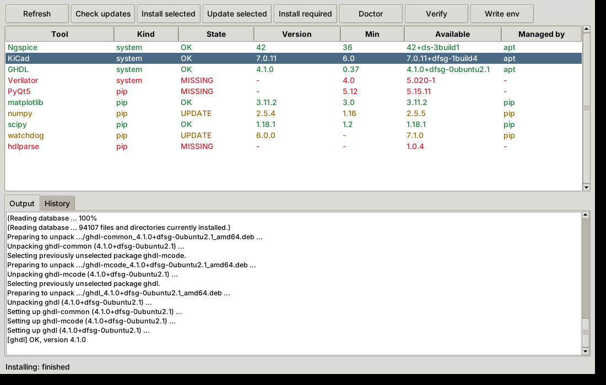

# eSim Automated Tool Manager (`esim-tm`)

A cross-platform tool, with a command line **and** a graphical interface, that
installs, version-checks, updates, verifies and configures the external tools
eSim depends on (Ngspice, KiCad, GHDL, Verilator and the Python libraries).
Pure Python standard library, no third-party dependencies.



Architecture: [docs/DESIGN.md](docs/DESIGN.md) | Demonstration: [docs/DEMO.md](docs/DEMO.md)

## What is verified, and how

| # | Deliverable | Status |
|---|---|---|
| 1 | Reliable Ngspice and KiCad detection | PATH, configured paths and per-OS install locations; fallback probes (`kicad-cli` then `kicad`, `ngspice -v`, `ngspice_con`). **Verified for real on Linux** (Ngspice 42, KiCad 7.0.11); KiCad 6 layout simulated; Windows/macOS install locations are untested on real installs |
| 2 | Accurate version checking | Regexes tested against real output formats; distro suffixes (`1:8.0.4+dfsg-1`) and pre-releases (`9.0.0~rc1 < 9.0.0`) handled. Unit-tested |
| 3 | Windows Chocolatey + Winget | Both implemented; Winget preferred when both exist, and each tool falls back to whichever manager actually has its package. Choco detection, dry-run and version lookup were run on a real Windows 11 machine; **Winget parsing is tested on sample output only and real Windows installs are not yet verified** |
| 4 | Linux APT | **Verified for real**: install, exact-version pin, bad-version error, remove-and-reinstall, update check |
| 5 | Automatic installation | `install` and one-shot `setup`; dependencies installed first. Real on Linux |
| 6 | Install and update verification | After every install/update the tool is re-probed; pin mismatches and "update changed nothing" are failures. `verify` re-checks on demand. **Real install and real pip update verified**; apt update verified with a fake backend only (nothing outdated to update) |
| 7 | Dependency and compatibility checking | `doctor`: Python, package manager, privileges, PEP 668, disk, network, minimum and recommended versions, required tools |
| 8 | History and error logging | JSON-lines history plus rotating debug log; failures record the actual error line from the command; `log --errors`, `log --json` |
| 9 | Automated tests on real OSes | 58 tests: 52 unit + 6 real-system tests (4 apply on Linux, the rest on Windows/macOS). **CI workflow for Ubuntu, Windows and macOS is included but has not run until you push the repo to GitHub** |
| 10 | Working GUI and demonstration | tkinter GUI, run and screenshotted for real under a virtual display on Linux; demo transcript and script. Windows/macOS look of the GUI not yet seen |

## Requirements

* Python 3.9+ (the GUI also needs tkinter: on Ubuntu `sudo apt install python3-tk`)
* One system package manager: `apt` / `dnf` / `pacman` (Linux), `brew` (macOS), `winget` or `choco` (Windows)
* `sudo` (Linux) or an Administrator terminal (Windows) for system installs

## Setup

```bash
git clone <your-repo-url> esim-tool-manager
cd esim-tool-manager

# Option A: run without installing  (Windows: use `python` instead of `python3`)
python3 -m esim_tool_manager --help

# Option B: install the `esim-tm` and `esim-tm-gui` commands (virtualenv recommended)
python3 -m venv .venv && source .venv/bin/activate      # Windows: .venv\Scripts\activate
pip install .
esim-tm --help
```

## Usage

Global flags (`--dry-run`, `-y/--yes`, `-v`, `--break-system-packages`) work before or after the subcommand.

```bash
esim-tm gui                           # graphical interface
esim-tm setup                         # check -> install required -> write env -> verify
esim-tm info                          # OS, distro, detected package managers
esim-tm doctor                        # dependency / compatibility check
esim-tm list [--json]                 # installed tools, versions, who manages them
esim-tm verify [tools] [--all]        # re-check that tools exist and are new enough

esim-tm --dry-run install ngspice     # preview the exact commands
esim-tm install ngspice               # install (asks first)
esim-tm install                       # every *required* tool;  --all adds optional ones
esim-tm install ngspice --version 42  # exact version (apt, winget, choco, pip)

esim-tm check-updates                 # installed vs. available versions
esim-tm update [tools]                # upgrade what has an update

esim-tm config pin ngspice 42         # `update` will leave it alone
esim-tm config unpin ngspice
esim-tm config set preferred_backend winget
esim-tm config set extra_paths "/opt/kicad/bin:/opt/ngspice/bin"
esim-tm config apply [--persist]      # esim_env.sh/.bat + tools_state.json

esim-tm log -n 30 [--errors] [--json] # history of installs, updates and errors
```

Exit codes: `0` success, `1` an operation failed or a check found errors, `2` bad usage.

State lives in `~/.esim_tool_manager/` (override with `ESIM_TM_HOME`): `config.json`,
`actions.jsonl`, `tool_manager.log`, `esim_env.sh|bat`, `tools_state.json`.

### GUI notes

System installs need privileges. On Linux the GUI uses `pkexec` (graphical password
prompt) when available; otherwise run `sudo python3 -m esim_tool_manager gui`. On
Windows start the terminal as Administrator.

### Python libraries on Ubuntu 23.04+ / Debian 12+ / Homebrew Python (PEP 668)

These systems mark their Python "externally managed", so `pip` refuses to install
into it. The tool detects this up front, `doctor` warns, and `install` explains the
fix. Use a virtualenv and run the tool from inside it:

```bash
python3 -m venv .venv && source .venv/bin/activate
pip install .
esim-tm install pyqt5 numpy matplotlib scipy
```

`--break-system-packages` overrides the guard (installs with `pip --user`).

## Testing

```bash
# Unit tests: no root, no network, no real installs (GUI test skips without a display)
python3 -m unittest discover -s tests -v
xvfb-run -a python3 -m unittest discover -s tests -v      # Linux, includes the GUI test

# Real-system tests: install real software; use a disposable machine or VM
ESIM_TM_INTEGRATION=1 python3 -m unittest tests.test_integration -v
```

The integration tests really install Ngspice with apt (Linux), query winget/choco
for KiCad (Windows) or Homebrew for Ngspice (macOS), pip-install into a virtualenv,
and run a real pip pin-then-update with verification. `.github/workflows/ci.yml`
runs both suites on Ubuntu, Windows and macOS for every push.

## Adding or changing a tool (no code needed)

Tools are declared in `esim_tool_manager/data/tools.json`. To add or override one,
create `~/.esim_tool_manager/tools.json` with the same schema:

```json
{
  "iverilog": {
    "name": "Icarus Verilog",
    "binary": "iverilog",
    "version_cmd": ["iverilog", "-V"],
    "version_regex": "version\\s+(\\d+(?:\\.\\d+)*)",
    "min_version": "11.0",
    "packages": {"apt": "iverilog", "brew": "icarus-verilog"}
  }
}
```

## Known limitations

* Not yet verified on real systems: Windows installs (Winget and Chocolatey),
  macOS, dnf, pacman, and the Windows/macOS appearance of the GUI. Their
  parsing and command building is covered by tests on sample output.
* Package IDs, `min_version` and `recommended_version` in `tools.json` are
  sensible defaults, not authoritative; confirm them against your eSim release
  and each package repository. Ngspice and Verilator have no Windows package
  defined, so the tool says "install manually" and links the homepage.
* `kicad --version` needs a display, so an old KiCad (without `kicad-cli`) on a
  headless machine shows as installed with an unknown version.
* Distro repositories can be older than eSim needs; the tool warns rather than
  pretending. dnf, pacman and Homebrew cannot pin versions (it warns and installs the latest).
* Some PyPI packages do not build on new Python versions (for example
  `hdlparse` 1.0.4); the tool reports the failure with a hint.
