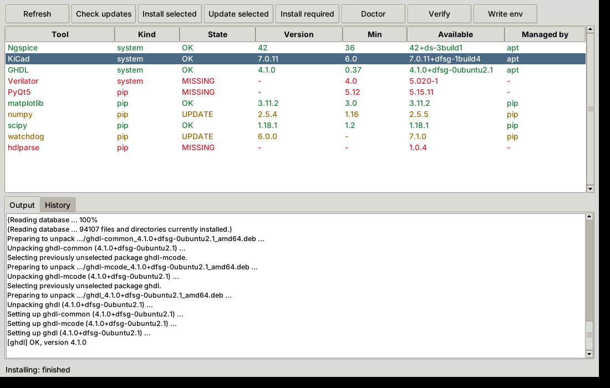
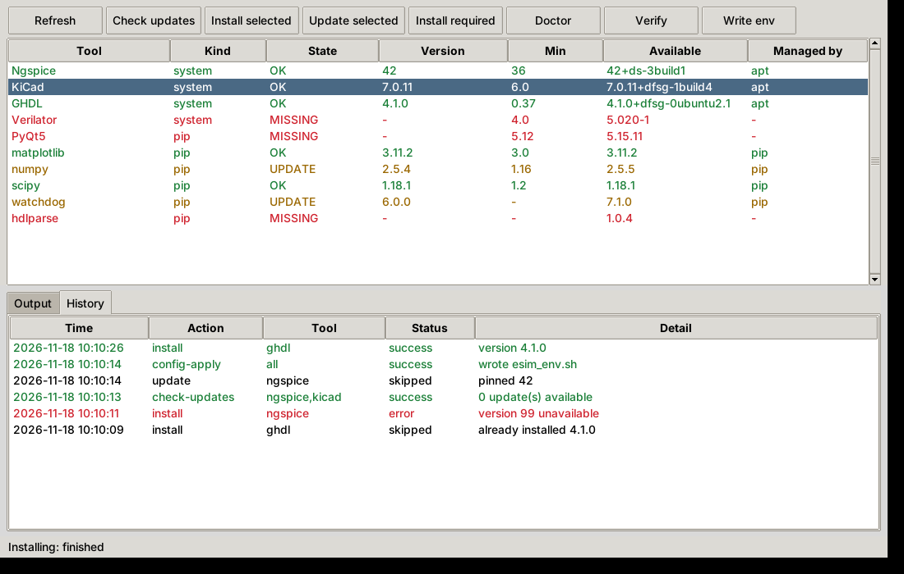

# Demonstration

## Graphical interface

Run `python3 -m esim_tool_manager gui` (or `esim-tm-gui`). Screenshots below are
from a real session on Ubuntu 24.04 in which GHDL was installed with the
**Install selected** button; the output pane shows the live apt output and the
state flipped to OK with the verified version.



The **History** tab lists every recorded action; errors are red.



| Button | What it does |
|---|---|
| Refresh / Check updates | Re-probe the system; the second also looks up the newest available versions |
| Install selected / Update selected | Act on the highlighted rows (asks first; runs in the background) |
| Install required | Installs every required tool that is missing |
| Doctor / Verify | Dependency report / pass-fail check of each tool |
| Write env | Generates `esim_env.sh` / `esim_env.bat` and `tools_state.json` |

Colours: green OK, amber update available, orange too old, red missing.

## Command-line walkthrough

Real output from Ubuntu 24.04 (apt), captured with `scripts/demo.sh`
(`asciinema rec demo.cast -c "bash scripts/demo.sh"` makes a recording).
Worth noticing: `doctor` gives a fix for every problem; `verify` re-checks the
real system; an impossible `--version` fails with what *is* available; a pinned
tool is protected from `update`; every step lands in the log, and `log --errors`
filters to problems.

```text

$ python3 -m esim_tool_manager info
      os: linux
  distro: Ubuntu 24.04.5 LTS
    arch: x86_64
  python: 3.12.3
   admin: True
backends: apt
   state: ~/.esim_tool_manager

$ python3 -m esim_tool_manager doctor
[ OK ] python: Python 3.12
[WARN] python env: system Python is externally managed (PEP 668)
         -> pip installs need a virtualenv: python3 -m venv .venv && source .venv/bin/activate
[ OK ] package manager: apt
[ OK ] privileges: sufficient
[ OK ] disk space: 9.9 GB free
[ OK ] network: reachable
[ OK ] ngspice: 42 (min 36)
[WARN] kicad: 7.0.11 works (min 6.0) but 8.0 is recommended
         -> A newer build is available from https://www.kicad.org
[ OK ] ghdl: 4.1.0 (min 0.37)
[WARN] verilator: missing
         -> Run: python3 -m esim_tool_manager install verilator
[FAIL] pyqt5: missing
         -> Run: python3 -m esim_tool_manager install pyqt5
[ OK ] matplotlib: 3.11.2 (min 3.0)
[ OK ] numpy: 2.5.4 (min 1.16)
[ OK ] scipy: 1.18.1 (min 1.2)
[ OK ] watchdog: 6.0.0 (min n/a)
[WARN] hdlparse: missing
         -> Run: python3 -m esim_tool_manager install hdlparse

1 error(s), 4 warning(s).

$ python3 -m esim_tool_manager list
TOOL        KIND    REQ  STATE    VERSION  MIN   MANAGED BY
----------  ------  ---  -------  -------  ----  ----------
ngspice     system  yes  OK       42       36    apt       
kicad       system  yes  OK       7.0.11   6.0   apt       
ghdl        system  opt  OK       4.1.0    0.37  apt       
verilator   system  opt  MISSING  -        4.0   -         
pyqt5       pip     yes  MISSING  -        5.12  -         
matplotlib  pip     yes  OK       3.11.2   3.0   pip       
numpy       pip     yes  OK       2.5.4    1.16  pip       
scipy       pip     yes  OK       1.18.1   1.2   pip       
watchdog    pip     opt  OK       6.0.0    -     pip       
hdlparse    pip     opt  MISSING  -        -     -         

$ python3 -m esim_tool_manager verify ngspice kicad
TOOL     RESULT  VERSION  PATH              
-------  ------  -------  ------------------
ngspice  PASS    42       /usr/bin/ngspice  
kicad    PASS    7.0.11   /usr/bin/kicad-cli

All required tools verified.

$ python3 -m esim_tool_manager --dry-run -y install ghdl
[ghdl] already installed (4.1.0), skipping

$ python3 -m esim_tool_manager install ngspice --version 99 -y
[ngspice] version 99 not offered by apt (available: 42+ds-3build1)

$ python3 -m esim_tool_manager check-updates ngspice kicad
TOOL     INSTALLED  AVAILABLE            STATUS    
-------  ---------  -------------------  ----------
ngspice  42         42+ds-3build1        up to date
kicad    7.0.11     7.0.11+dfsg-1build4  up to date

0 update(s) available.

$ python3 -m esim_tool_manager config pin ngspice 42
pinned ngspice to 42

$ python3 -m esim_tool_manager update ngspice -y
[ngspice] pinned to 42, skipping (use `python3 -m esim_tool_manager config unpin ngspice`)

$ python3 -m esim_tool_manager config unpin ngspice
unpinned ngspice

$ python3 -m esim_tool_manager config apply
Wrote ~/.esim_tool_manager/esim_env.sh. Use: source ~/.esim_tool_manager/esim_env.sh

$ python3 -m esim_tool_manager log -n 8
TIME                 ACTION         TOOL           STATUS   DETAIL                 
-------------------  -------------  -------------  -------  -----------------------
2026-11-18 10:10:09  install        ghdl           skipped  already installed 4.1.0
2026-11-18 10:10:11  install        ngspice        error    version 99 unavailable 
2026-11-18 10:10:13  check-updates  ngspice,kicad  success  0 update(s) available  
2026-11-18 10:10:14  update         ngspice        skipped  pinned 42              
2026-11-18 10:10:14  config-apply   all            success  wrote esim_env.sh      

Full debug log: ~/.esim_tool_manager/tool_manager.log

$ python3 -m esim_tool_manager log --errors
TIME                 ACTION   TOOL     STATUS  DETAIL                
-------------------  -------  -------  ------  ----------------------
2026-11-18 10:10:11  install  ngspice  error   version 99 unavailable

Full debug log: ~/.esim_tool_manager/tool_manager.log
```

## One-shot setup

`esim-tm setup` runs the whole flow: system check, install required tools,
write the environment files, verify. On a system Python with PEP 668 it installs
the system tools and explains how to handle the Python libraries instead of
failing with a raw pip error.
