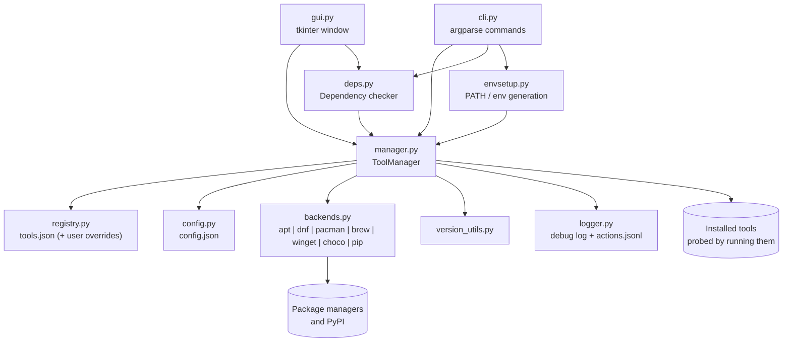
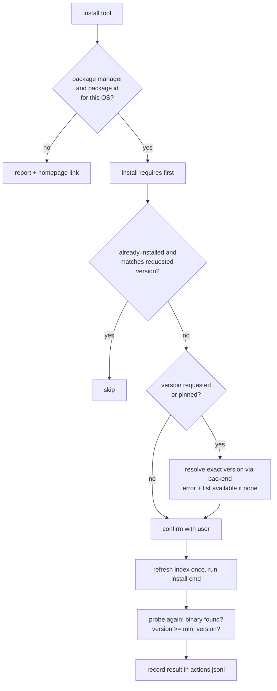

# Design Document: eSim Automated Tool Manager

## 1. Goals and scope

eSim relies on external tools (Ngspice, KiCad, GHDL, Verilator) and Python
libraries (PyQt5, matplotlib, numpy, scipy, ...). Installing and keeping them
compatible by hand is error-prone. `esim-tm` automates:

1. **Installation** with OS detection and optional version pinning
2. **Updates** (detect and apply, with minimal manual intervention)
3. **Configuration** (PATH, environment variables, pins)
4. **Dependency checking** with actionable feedback
5. **A CLI and a GUI** to inspect tools/versions and review a log of actions

Non-goals for this prototype: building tools from source, managing
multiple isolated eSim environments.

## 2. Design principles

* **Delegate to native package managers** (apt, brew, choco, pip) instead of
  downloading binaries ourselves. They already handle dependencies, signatures,
  and upgrades, which avoids reinventing a fragile and less secure installer.
* **Data, not code, describes tools.** A JSON registry defines each tool; adding
  one needs no Python changes.
* **Probe reality, don't trust records.** Installed version is always read by
  running the tool (`ngspice --version`), so manual installs are detected too.
  The package manager is used only to find *available* versions and to act.
* **Safe by default.** Confirmation prompts, `--dry-run`, no shell
  interpolation (commands are argument lists), no root unless needed.
* **Small, replaceable parts.** OS-specific logic is confined to backends.

## 3. Architecture

### 3.1 Module breakdown

| Module | Responsibility |
|---|---|
| `gui.py` | tkinter front end over `ToolManager`: table, buttons, live output, history, doctor. Work runs in background threads and reaches the window only through a queue, so it never freezes or touches widgets from a worker thread. |
| `cli.py` | Parses arguments, formats tables, maps commands to manager calls, sets exit codes. Contains no business logic. |
| `manager.py` | Core engine: `probe` / `status` (what is installed), `install`, `check_updates`, `update`. Handles dependency ordering, pins, confirmation, verification after install and update, privilege elevation, dry-run, and streaming of command output (keeping the tail so failures are explained in the history). |
| `backends.py` | One class per package manager behind a common interface: `installed_version`, `candidate_version`, `list_versions`, `resolve_version`, `install_cmd`, `upgrade_cmd`, `refresh_cmd`. |
| `registry.py` | Loads `data/tools.json` plus the optional user file and builds `Tool` objects. |
| `deps.py` | System checks (Python, package manager, privileges, disk, network) and per-tool checks (present, meets minimum version, required tools present). |
| `envsetup.py` | Generates `esim_env.sh/.bat` and `tools_state.json`; optional shell-rc hook. |
| `config.py` | Persisted user settings: preferred backend, version pins, extra search paths and env vars. |
| `version_utils.py` | Normalises messy versions (`1:8.0.4+dfsg-1` -> `8.0.4`), compares, evaluates `>=` style specs. |
| `logger.py` | Rotating debug log and a structured JSON-lines action history. |
| `platform_utils.py` | OS, distro, architecture, admin detection. |

### 3.2 Tool descriptor (registry schema)

| Field | Meaning |
|---|---|
| `kind` | `system` (binary on PATH) or `pip` (Python distribution) |
| `binary`, `version_cmd`, `version_regex` | How to find the tool and extract its version |
| `min_version`, `recommended_version` | Compatibility floor for eSim / informational target |
| `packages` | Map of backend name to package id (`"brew": "cask:kicad"` selects a cask) |
| `requires` | Other tool ids that must be installed first |
| `search_paths` | Per-OS glob patterns for tools that are not on PATH (e.g. KiCad on Windows) |
| `fallback_probes` | Alternative executables tried if the primary is absent (`kicad-cli` exists only from KiCad 7, so KiCad 6 is found via `kicad`) |
| `required` | Whether the tool is part of the default install set |

## 4. Key workflows

### 4.1 Install

Post-install verification catches the common silent failure where a distro
package installs successfully but is older than eSim requires; this is reported
as a warning with guidance rather than a false "success".

Verification is strict: a pinned install whose resulting version does not match the
request fails, and so does an update that leaves the version below the offered
candidate (for example a stale PATH). `verify` repeats the check on demand.

**Backend choice per tool:** the configured backend first, then the first
available one that actually has a package id for that tool (on Windows Winget
lacks GHDL while Chocolatey has it, so each tool uses whichever can install it).

### 4.2 Update

`check-updates` compares the **probed** version with the backend's **candidate**
version. `update` upgrades a tool only if (a) a newer candidate exists, (b) it
is not pinned, and (c) it is managed by the package manager. Manually installed
tools are reported, not touched, so the manager never overwrites a setup it did
not create.

### 4.3 Configuration

`config apply` probes every tool and writes:

* `esim_env.sh` / `esim_env.bat`: prepends tool directories to `PATH` and exports
  `ESIM_<TOOL>_BIN` plus any user-defined variables
* `tools_state.json`: resolved paths and versions, a stable interface for eSim
  or other scripts to consume instead of re-detecting tools
* optionally (`--persist`, POSIX) an idempotent line in `~/.bashrc`/`~/.zshrc`

On Windows the manager does not modify the system PATH automatically (risky,
and `setx` truncates long values); it generates the `.bat` instead.

### 4.4 Dependency checking (`doctor`)

System level: Python >= 3.8, a package manager present, root/sudo (or an
elevated Windows terminal), >= 2 GB free disk, network reachability. Tool
level: installed, meets `min_version`, `requires` satisfied. Each failing check
prints a one-line **hint** with the exact fix command.

## 5. Cross-cutting concerns

* **PEP 668 (externally managed Python):** the pip backend detects the
  `EXTERNALLY-MANAGED` marker outside a virtualenv and refuses up front with the
  venv instructions; `--break-system-packages` is an explicit opt-in. `doctor`
  reports the same condition.
* **Cross-platform:** backend selection by OS; Windows uses Chocolatey,
  macOS Homebrew, Linux apt/dnf/pacman. Binaries missing from PATH are found
  via per-OS `search_paths`.
* **Version control:** exact pins work on apt (`pkg=ver` resolved via
  `apt-cache madison`), Chocolatey (`--version`) and pip (`==`). Backends that
  cannot pin (dnf, pacman, brew) warn and install the latest.
* **Security:** commands are argument lists (no shell, so no injection from
  tool names or versions); `sudo` is added only for backends that need it and
  only when not already root; confirmation is required unless `-y`; downloads
  are done by the system package manager, which verifies signatures.
* **Logging and auditability:** every action is appended to `actions.jsonl`
  (success, skipped, error, warning, dry-run, cancelled); full command lines and
  exit codes go to `tool_manager.log`.
* **Error handling:** missing binaries, failed commands, unavailable versions,
  corrupt config and broken pipes produce clear messages and non-zero exit
  codes instead of tracebacks.
* **Testing on real systems:** `tests/test_integration.py` (opt-in via
  `ESIM_TM_INTEGRATION=1`) performs real installs and lookups, and
  `.github/workflows/ci.yml` runs unit and real-system suites on Ubuntu,
  Windows and macOS. The workflow has not run until the repository is pushed.
* **Detection and versions:** each tool can have several probes and per-OS
  search paths; versions are normalised (epoch, distro suffix) and pre-releases
  sort before finals (`9.0.0~rc1 < 9.0.0`).
* **Unit tests:** 52 tests: version logic, registry validity, the manager flows
  (install, skip, pin, bad version, update, pinned-skip) against an in-memory
  `FakeBackend`, parsing for every backend on realistic mocked output, PEP 668
  handling, KiCad 6/7 probing and CLI behaviour. No root or network required.

## 6. Limitations and future work

* Ubuntu/apt is verified end to end and Windows/Chocolatey for detection and
  dry-run; the dnf, pacman, Homebrew and Chocolatey install paths are covered by
  parsing tests on mocked output only and need testing on real systems.
* Package ids and minimum versions are defaults that should be validated per
  eSim release (a version-matrix file per eSim release would make this
  authoritative).
* Distro repositories can be older than eSim requires. Future: add per-tool
  fallback installers (PPA, official tarballs or installers with checksum
  verification) when the repo version is below `min_version`.
* Rollback (reinstall the previous version recorded in the action log) and
  winget support.
* A PyQt5 front end for embedding in eSim itself: `ToolManager` is already
  UI-independent (output goes through an injectable `out` callable), which is
  how the tkinter GUI is built.
